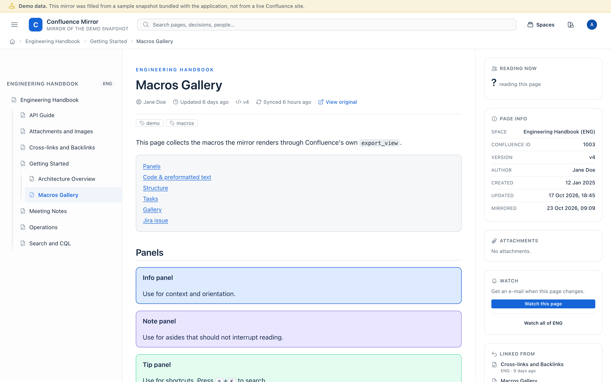

# Confluence Mirror

[](https://github.com/d-led/confluence_phx_mirror/actions/workflows/ci.yml)
[](LICENSE)

**A read-only copy of a Confluence site that keeps answering when Confluence is
slow, locked down, being retired — or simply not where you are.** Run it on a
laptop or any container host. Everything it holds can leave as files that open
without it.



*The bundled demo: the page tree on the left, Confluence's own rendering in the
middle, the page's id, version and original URL in the rail.*

## Why people run it

| | |
| --- | --- |
| **It fills in gradually** | A large site answers within minutes and fills page by page while it reads. Progress is on screen, and one broken page is reported instead of failing the run. |
| **Macros survive** | Pages keep Confluence's own rendering, so layout, expanders, task lists and most macros look right. A macro that cannot work offline names itself instead of leaving a hole. |
| **Permissions come along** | Page restrictions and space permissions are mirrored: a page someone may not see is a `404` for them here too. |
| **Open or closed** | Publish it as a read-only site anyone can open, or put it behind your existing sign-in proxy. |
| **Nothing is trapped** | One page, one space or the whole site, as Markdown or as a static website, with attachments — readable from disk, no server. |
| **Search stays local** | Titles, page bodies, labels and space filters; a static archive carries its own offline search. |

It never writes back: no uploads, no edits, no page history.

## Start here

| I want… | Time | Go to |
| --- | --- | --- |
| **a copy on my laptop** (macOS, Windows, Linux app) | ~2 min | [The desktop app](#the-desktop-app) |
| **to see it working** (demo content, Docker only) | ~4 min | [Try it, one command](#try-it-one-command) |
| **to mirror my own site** (public read-only, no sign-in) | ~5 min, then the first pull | [Mirror your site](#mirror-your-site) |
| **to deploy it** (Fly.io, or any container host) | ~20 min | [Deploy it](#deploy-it) |

Docker is the only prerequisite for the middle two: both run our image, and the
database comes with it. Mirroring a real site also needs an Atlassian API token.

## The desktop app

The same mirror as one double-clickable app: SQLite instead of Postgres, no
Docker, no shell. Best for "point it at one site and take a copy of it". The
site's token goes to your keychain on first launch.

| platform | download |
| --- | --- |
| macOS (Apple silicon) | [`confluence-export-macos.zip`](https://nightly.link/d-led/confluence_phx_mirror/workflows/desktop-release/main/confluence-export-macos.zip) |
| Linux x64 | [`confluence-export-linux.zip`](https://nightly.link/d-led/confluence_phx_mirror/workflows/desktop-release/main/confluence-export-linux.zip) |
| Windows x64 | [`confluence-export-windows.zip`](https://nightly.link/d-led/confluence_phx_mirror/workflows/desktop-release/main/confluence-export-windows.zip) |

Or one line, which is what most people want:

```sh
# macOS (Apple silicon) and Linux (x86_64)
curl -fsSL https://raw.githubusercontent.com/d-led/confluence_phx_mirror/main/install-desktop.sh | sh
```

```powershell
# Windows (x64), in PowerShell
powershell -ExecutionPolicy Bypass -Command "irm https://raw.githubusercontent.com/d-led/confluence_phx_mirror/main/install-desktop.ps1 | iex"
```

The shell one puts the app in `~/Applications` on macOS, and the tool in
`~/.local/share/confluence-export` with a launcher in `~/.local/bin` on Linux;
the PowerShell one uses `%LOCALAPPDATA%\Programs` and adds a Start Menu entry.
Run either again to take the newest build.

Each link is the newest successful build on `main`; a `v*` tag also attaches the
three builds to [Releases](https://github.com/d-led/confluence_phx_mirror/releases).
Nothing is signed, so macOS stops the first launch of a downloaded copy
(`install-desktop.sh` clears that flag), and Windows asks for *More info → Run
anyway*. [The desktop tool](docs/desktop-tool.md) has the rest.

## Try it, one command

Demo content, Docker only, no account:

```bash
docker compose -f docker-compose.demo.yml up
```

| What | Where |
| --- | --- |
| the mirror | <http://localhost:4000> |
| admin dashboard | <http://localhost:4000/admin> |
| live sync log | <http://localhost:4000/admin/sync-log> |
| audit log | <http://localhost:4000/admin/audit> |

**Done when** the home page says `40 pages` in two spaces and `/admin` shows one
finished sync — that happens by itself a second or two after the container
starts.

`docker compose -f docker-compose.demo.yml down` stops it; add `-v` to drop the
database and the files with it.

## Mirror your site

One command, for a mirror **anyone can read** — readers do not sign in. You need
an Atlassian API token ([create one](https://id.atlassian.com/manage-profile/security/api-tokens);
it is shown once) on an account with Confluence product access:

```bash
export CM_CONFLUENCE_SITE=https://acme.atlassian.net   # "/wiki" optional
export CM_ATL_EMAIL=you@acme.com            # the account the token belongs to
export CM_ATL_TOKEN=...
export SECRET_KEY_BASE=$(openssl rand -hex 48)

docker compose -f docker-compose.site.yml up
```

Then open <http://localhost:4000>. The first pull starts by itself and the page
fills as it reads. `CM_SPACES=ENG,PROD` narrows the mirror to some spaces
instead of everything the token can see.

**Done when** the home page lists your spaces. A big site takes hours on the
first pull; the measured pace is in
[performance.md](docs/performance.md#what-it-measured).

**Public still means permissioned.** `CM_PUBLIC_SITE=true` in that file makes a
reader with no account a reader, and that reader still sees only what the
mirrored permissions allow: a space whose permissions the sync never stored is
closed to them, not open. The exact rule, and the two switches that decide what
a stranger sees inside a public page, are in
[routes-auth.md](docs/routes-auth.md#public-documentation-sites).

**Prefer it private?** Drop `CM_PUBLIC_SITE` and put an OAuth proxy in front —
[deployment.md](docs/deployment.md). Administration is a separate door and off
by default.

Accounts, permissions, webhooks, themes:
[site-admin-guide.md](docs/site-admin-guide.md).

## Deploy it

It is a normal 12-factor release, so **any host that runs containers works**. It
needs three things:

* a persistent volume for attachments;
* a Postgres database (`DATABASE_URL`) — Fly's own, or any managed one;
* the environment variables in [configuration.md](docs/configuration.md).

### On Fly.io

```bash
./scripts/fly-provision.sh live       # once: apps, database, volume, secrets
./scripts/fly-deploy.sh live          # every version: the mirror
./scripts/fly-deploy.sh live --proxy  # …and its front door, when that changed
```

`--check` verifies that a deploy would work without deploying anything;
`--sync` also queues a full snapshot afterwards.

**Change the app name first.** Fly app names are unique across all of Fly, and
the ones in this repo are ours: `confluence-mirror-app` (the mirror),
`confluence-mirror` (its proxy) and `confluence-mirror-db` (the database). Pick
your own in `fly.toml`, in `deploy/fly/proxy/fly.toml` (including
`OAUTH2_PROXY_UPSTREAMS`, which names the backend app) and at the top of the two
scripts — otherwise the deploy stops on a name that is already taken.

**Done when** the proxy's URL answers and `/admin` shows the build you deployed.

| | Where |
| --- | --- |
| step by step: Fly.io and its OAuth proxy | [deployment.md](docs/deployment.md) |
| step by step: Kubernetes | [deployment.md](docs/deployment.md#kubernetes) |
| environment contract, migrations, backups, pool sizing | [operations.md](docs/operations.md) |
| every setting, and which ones need a restart | [configuration.md](docs/configuration.md) |

### Anywhere else

A release carries everything but the configuration: no compiler, no Node, no
state on disk except the blob root. Build the image with the `Dockerfile` and
run the three commands a deploy needs — migrate, then serve:

```bash
docker build -t confluence-mirror .
docker run --rm -e DATABASE_URL=… -e SECRET_KEY_BASE=… confluence-mirror /app/bin/migrate
docker run -p 4000:4000 -v mirror-blobs:/app/var/mirror -e … confluence-mirror
```

A release that mirrors a real site **refuses to start** with the sign-in-free
switches on (`MIRROR_AUTO_ADMIN`, `MIRROR_SELF_SIGNUP`, `CM_PROXY_AUTH`) unless
`MIRROR_ALLOW_UNSAFE_IDENTITY=1` says you meant it.


## Take a copy with you

| You want | What you get |
| --- | --- |
| one page | Markdown |
| one page with its images and files | a ZIP: the `.md` plus `attachments/` |
| a space | Markdown in the page hierarchy, each page's files beside it |
| a space as a website | HTML pages, the same pages as Markdown, offline search, labels, attachments, the site's theme |
| the whole site | every space in one static-site archive (administrators) |

Everything works from disk — no server, no network, no build step — and an
archive holds only what its reader may open. The buttons are under each space's
**Export**, on the page rail, and on the admin dashboard. Details:
[site-admin-guide.md](docs/site-admin-guide.md#exporting-the-mirror).

## Honest limits

No uploads or write-back, no page history, no templates. Space permissions exist
only where Confluence still reports them — Cloud usually does not, so pages
there are narrowed by page restrictions and by the administrator. A macro that
needs the live site (a query, a form, a ticking clock) cannot be answered from a
stored page: it says what it was instead of guessing. Each edge and its reason:
[known limitations](docs/design-notes.md#known-limitations).

## Documentation

| You are… | Read |
| --- | --- |
| the site administrator: syncing, accounts, permissions, webhooks, themes | [site-admin-guide.md](docs/site-admin-guide.md) |
| deploying and operating it: build, env contract, migrations, backups | [operations.md](docs/operations.md) · [deployment.md](docs/deployment.md) |
| looking for a setting | [configuration.md](docs/configuration.md) |
| integrating: JSON API, Confluence-compatible REST, MCP | [api.md](docs/api.md) · [mcp.md](docs/mcp.md) |
| working on the code: the one-page map, invariants, tests, gates | [architecture.md](docs/architecture.md) · [developers.md](docs/developers.md) |
| wondering why it is built this way, or what it cannot do | [design-notes.md](docs/design-notes.md) |
| reporting a vulnerability | [SECURITY.md](SECURITY.md) |

## License

Mozilla Public License 2.0 — the full text is in [LICENSE](LICENSE), and
`mix.exs` declares `MPL-2.0` to Hex and tooling.

MPL is file-scoped copyleft: a modified file stays under the MPL, while the rest
of your system may use other terms. Running the mirror as a service is not
distribution. Contributions come in under the same licence.

