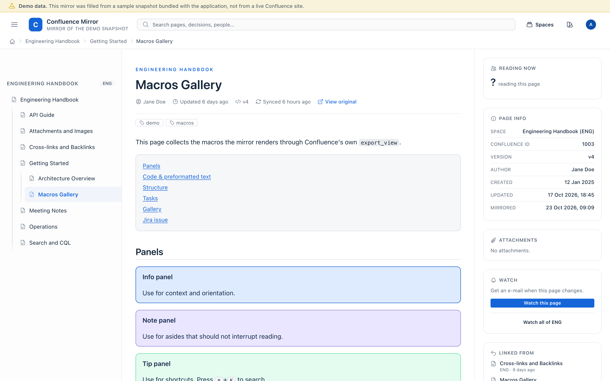
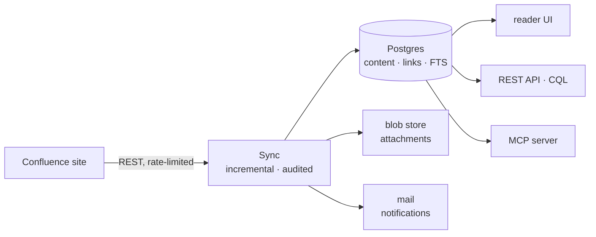

# Confluence Mirror

[](https://github.com/d-led/confluence_phx_mirror/actions/workflows/ci.yml)
[](LICENSE)
[](mix.exs)

A **read-only** mirror of a Confluence site.

Phoenix 1.8 · LiveView 1.2 · Ecto/Postgres · Elixir 1.20.

It keeps Confluence's own `export_view` rendering, so macros look right. It
rewrites internal links so mirrored pages cross-link each other, serves
attachments from a blob store, indexes everything with Postgres full-text search
behind a CQL subset, and keeps two logs: an audit log of decisions and a live
log of what each sync is doing.



*The bundled demo snapshot: the branch of its space on the left, Confluence's
own rendering in the middle, and a rail naming the Confluence id, version,
author and the original URL.*

## Pick a path

| I want to… | Time | Jump to |
| --- | --- | --- |
| **see it working** (bundled demo, no credentials) | ~3 min | [See it working](#1-see-it-working) |
| **mirror a real Confluence site** | ~10 min, then a sync | [Mirror a real site](#2-mirror-a-real-site) |
| **deploy it** (Fly.io or Kubernetes) | ~20 min | [Deploy it](#3-deploy-it) |
| run it in production | — | [operations.md](docs/operations.md) |
| change the code | — | [developers.md](docs/developers.md) |

You need **Elixir 1.20+**, **Node.js with npm**, and **Docker** (for the local
Postgres). Mirroring a real site also needs an Atlassian API token.

## 1. See it working

The bundled demo snapshot needs no Confluence account.

```bash
docker compose up -d     # Postgres, Adminer, smtp4dev
mix setup                # deps, database, migrations, assets, demo content
mix phx.server
```

Then open:

| What | Where |
| --- | --- |
| the mirror | <http://localhost:4000> |
| admin dashboard | <http://localhost:4000/admin> |
| live sync log | <http://localhost:4000/admin/sync-log> |
| audit log | <http://localhost:4000/admin/audit> |
| mail sink (smtp4dev) | <http://localhost:3001> |
| database UI (Adminer) | <http://localhost:8092> |
| LiveDashboard | <http://localhost:4000/dev/dashboard> |

**Done when** the home page lists spaces and `/admin` shows one finished sync.

Development and test assume an administrator (`MIRROR_AUTO_ADMIN`), so nothing
asks you to sign in. Reader accounts use passwordless magic links.

**If it stops:** a missing `node`/`npm` is the usual first-run failure, and
Postgres has to be up before `mix setup`.

### Three setup commands that look alike

| Command | What it does |
| --- | --- |
| `mix setup` | a fresh checkout: deps, database, migrations, assets |
| `mix ecto.setup` | *only* the database for the configured source, plus a first sync |
| `mix ecto.reset` | drop that database, then `ecto.setup` |

## 2. Mirror a real site

Three variables are the whole contract:

```bash
export CM_CONFLUENCE_SITE=https://acme.atlassian.net   # "/wiki" optional
export CM_ATL_EMAIL=you@acme.com
export CM_ATL_TOKEN=...          # API token, see below
export CM_SPACES=ENG,PROD        # optional; default is every visible space
```

Create the token at
<https://id.atlassian.com/manage-profile/security/api-tokens> (*Create API
token*). It is shown once, so copy it straight into the variable. The account
needs **Confluence product access** on that site.

Then:

```bash
mix confluence.probe        # optional: are the URL and the token good?
mix ecto.setup              # create this site's database, take a first snapshot
scripts/start-mirrored.sh   # serve that site
```

**Done when** `mix confluence.probe` names your account and `/admin` shows a
finished sync with pages.

Three things that save a support round-trip:

* **The first snapshot is the slow part.** Minutes to hours, depending on the
  site; watch `/admin/sync-log`.
* **Each source gets its own database** (`…_dev_acme_atlassian_net`), so demo
  content and a real site never mix. Switching is only a matter of the
  environment.
* **The server logs to your terminal.** Redirect it for a file:
  `scripts/start-mirrored.sh > /tmp/mirror_server.log 2>&1`.

A token is read from the environment on purpose: nothing about it is written to
the repo.

Knobs worth knowing: `CM_REQUESTS_PER_SECOND` / `CM_BURST` (the client's token
bucket), `CM_SYNC_CONCURRENCY`, `CM_RECONCILE_INTERVAL_SECONDS`, `PORT`. The
exhaustive list is [configuration.md](docs/configuration.md).

Accounts, permissions, webhooks, themes:
[site-admin-guide.md](docs/site-admin-guide.md).

## 3. Deploy it

Two commands, one per question:

```bash
./scripts/fly-provision.sh live       # once: apps, database, volume, secrets
./scripts/fly-deploy.sh live          # every version: the mirror
./scripts/fly-deploy.sh live --proxy  # …and its front door, when that changed
```

`--check` verifies that a deploy would work without deploying anything;
`--sync` also queues a full snapshot afterwards. A release ships the mirror and
stops there — the oauth2-proxy has an image of its own and changes rarely, so it
joins only with `--proxy`, or on its own with `--proxy-only`.

**Done when** the proxy's URL answers and `/admin` shows the build you deployed.

| | Where |
| --- | --- |
| step by step: Fly.io and its OAuth proxy | [deployment.md](docs/deployment.md) |
| step by step: Kubernetes | [deployment.md](docs/deployment.md#kubernetes) |
| environment contract, migrations, backups, pool sizing | [operations.md](docs/operations.md) |
| every setting, and which ones need a restart | [configuration.md](docs/configuration.md) |

Prefer another platform? It is a 12-factor release — configuration only from the
environment, no state on disk except the blob root:

```bash
MIX_ENV=prod ./scripts/mix_release.sh
bin/confluence_phx_mirror eval "ConfluencePhxMirror.Release.migrate"
PHX_SERVER=true DATABASE_URL=… SECRET_KEY_BASE=… bin/confluence_phx_mirror start
```

A release that mirrors a real site **refuses to start** with the sign-in-free
switches on (`MIRROR_AUTO_ADMIN`, `MIRROR_SELF_SIGNUP`, `CM_PROXY_AUTH`) unless
`MIRROR_ALLOW_UNSAFE_IDENTITY=1` says you meant it.

## What it does



* **Keeps Confluence's own rendering** — pages are stored as sanitised
  `export_view`, so macros look right without re-implementing them. Browser-only
  macros are resolved from the mirror's own data or reported as unavailable.
* **Says whose wiki it is** — the site's name in the header, the original URL on
  every page.
* **Pulls only what changed** — a page whose Confluence version is unchanged is
  not re-rendered and not asked for its attachments and comments.
* **Stable, Confluence-shaped URLs** — content is keyed by `confluence_id` and
  version, old slugs redirect, and Confluence's `/wiki` links work after
  changing only the host.
* **Mirrored permissions** — page restrictions and (where the source supplies
  them) space permissions are replayed; a hidden page is a `404`.
* **Search that stays in Postgres** — a CQL subset plus structured filters over
  GIN-indexed `tsvector`, arrays and trigrams, with an advanced panel in the
  reader UI and a REST API beside it.
* **Attachments in a blob store** — path-based keys, atomic writes, never in
  Postgres or `priv/static`.
* **Two logs, for two questions** — the audit log says *who changed what*;
  `/admin/sync-log` streams *what the sync is doing* while it runs.
* **Nothing silently lost** — a failing page does not abort a run. It is
  collected, reported, and the run ends `partial` instead of claiming success.
* **Read-only by design** — no uploads, no write-back, no page history.

## Requirements

| Need | Why |
| --- | --- |
| Elixir 1.20+ / OTP 29 | `mix.exs` requires `~> 1.20`; the image builds on `hexpm/elixir:1.20.4-erlang-29.1.2-debian-trixie` |
| Node.js with npm | `mix setup` runs `npm ci` in `assets/`; a missing `node` is what stops a first run |
| Postgres 12+ | the search index is a stored generated column |
| Docker | only for the local Postgres and the mail sink; anywhere else it is `DATABASE_URL` |

## What it does not do

Uploads and write-back, page history and templates. Space permissions exist only
where the source can supply them, and browser-only macros cannot be resolved
offline. Each edge and its reason:
[known limitations](docs/design-notes.md#known-limitations).

## Documentation

| You are… | Read |
| --- | --- |
| in a hurry: one page of components, data, ingestion, search, authorization and deployment | [architecture.md](docs/architecture.md) |
| the site administrator: syncing, accounts, permissions, webhooks, themes | [site-admin-guide.md](docs/site-admin-guide.md) |
| deploying and operating it: build, env contract, migrations, monitoring, backups | [operations.md](docs/operations.md) |
| deploying to Fly.io or Kubernetes, behind an OAuth proxy | [deployment.md](docs/deployment.md) |
| looking for a setting | [configuration.md](docs/configuration.md) |
| asking who may reach which route, and what they may read | [routes-auth.md](docs/routes-auth.md) |
| integrating: JSON API, Confluence-compatible REST, CQL | [api.md](docs/api.md) |
| letting an AI assistant read the wiki (MCP) | [mcp.md](docs/mcp.md) |
| working on the code: invariants, tests, quality gates | [developers.md](docs/developers.md) |
| measuring a reader's screens, or load-testing a server | [performance.md](docs/performance.md) |
| wondering why it is built this way | [design-notes.md](docs/design-notes.md) |
| reporting a vulnerability | [SECURITY.md](SECURITY.md) |

## License

Mozilla Public License 2.0 — the full text is in [LICENSE](LICENSE), and
`mix.exs` declares `MPL-2.0` to Hex and tooling.

MPL is file-scoped copyleft: if you distribute a modified version of a file,
that file has to stay under the MPL, while the rest of your system may be under
other terms. Running the mirror as a service is not distribution. Contributions
are accepted under the same licence.

