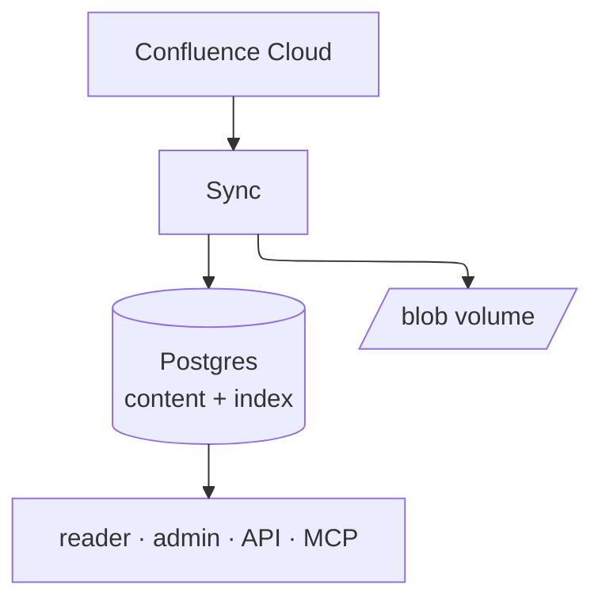
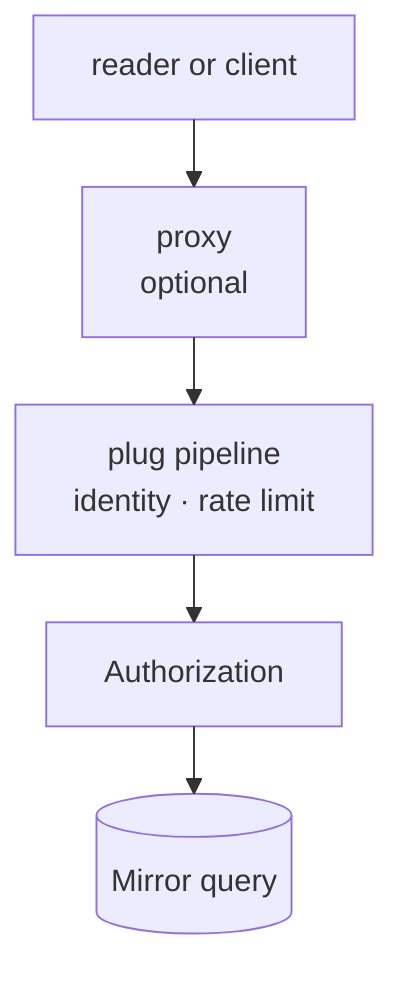
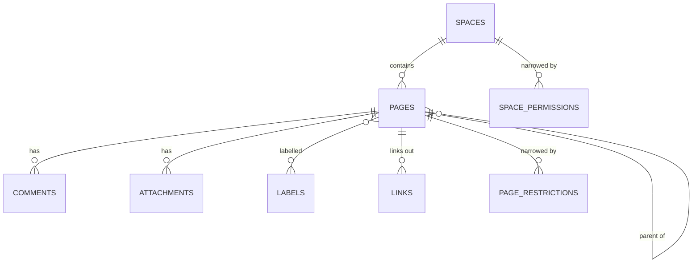
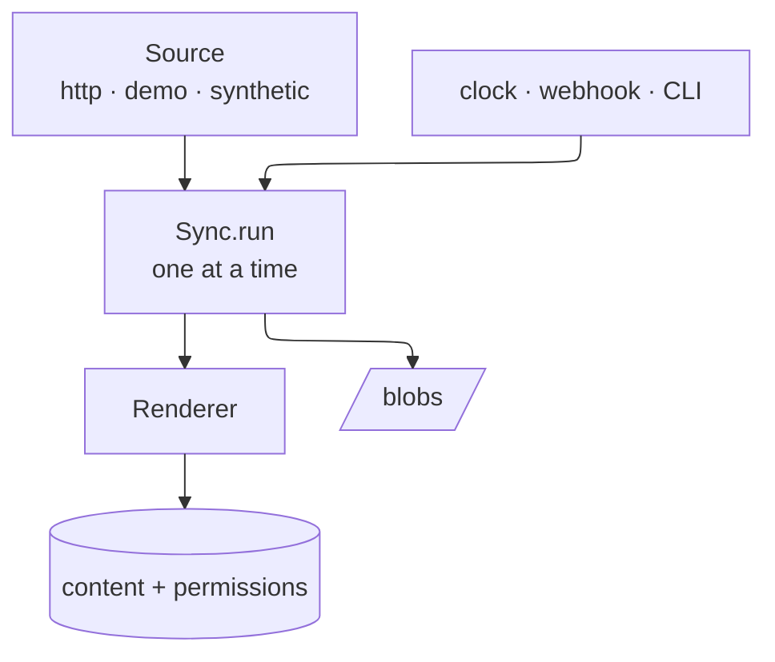
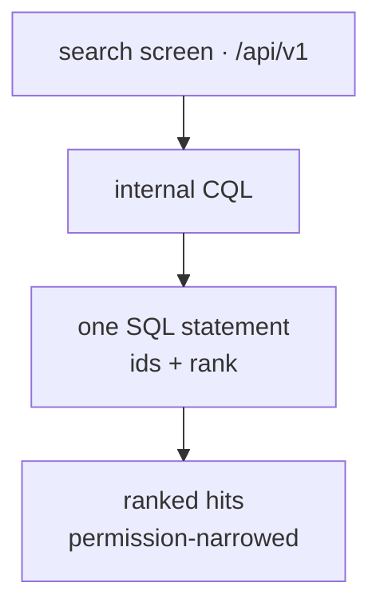
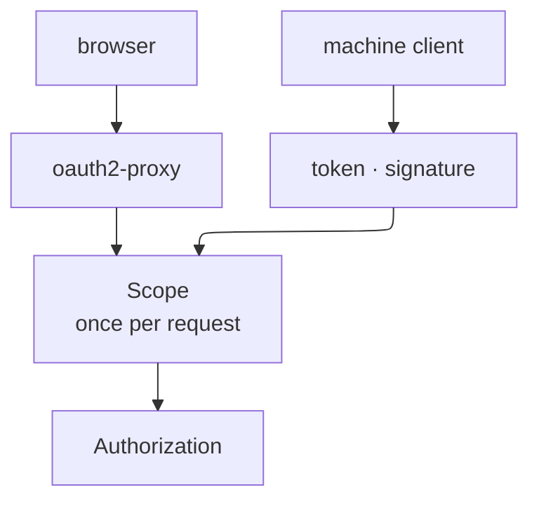
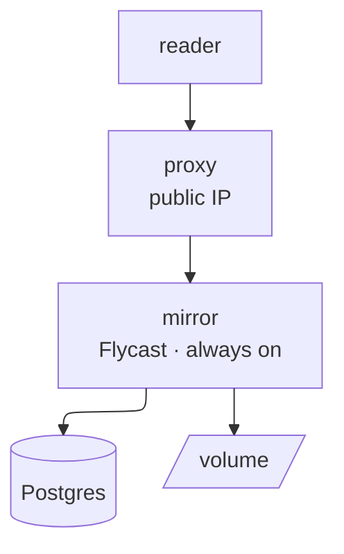
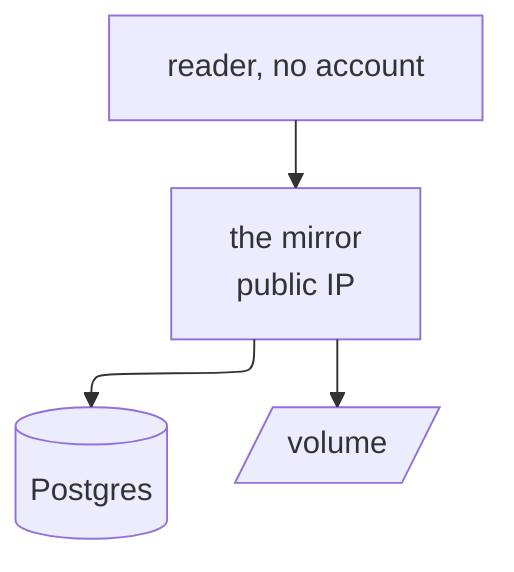

# Architecture

A **read-only mirror of a Confluence site**. One Phoenix release reads a site
over its REST API, renders what it read, stores it in Postgres and on a volume,
and serves readers, an administrator area, a JSON API and an MCP server. Nothing
a reader does changes content: the only writer is the sync.

This page is the **map** — what the pieces are, how they fit, which guide has
the detail. Read it in five minutes; every section stands alone.

## Pick a view

| you want to know | go to |
| --- | --- |
| what runs, and what a request passes | [Runtime](#runtime-one-release-five-faces) |
| what is stored, and where | [Data](#data-what-the-mirror-knows) |
| how content gets in | [Ingestion](#ingestion-the-only-writer) |
| how a search finds a page | [Search and indexing](#search-and-indexing-how-a-query-becomes-a-list) |
| who may reach what, and read what | [Identity and authorization](#identity-and-authorization-three-questions) |
| how it runs on Fly.io today | [Deployment A](#deployment-a--flyio-what-ships-today) |
| how an *open* site would run | [Deployment B](#deployment-b--an-open-site-phoenix--postgres) |
| what changes with more than one node | [Clustering](#clustering-in-one-paragraph) |
| how an assistant reads the wiki | [Machine surfaces](#machine-surfaces-api-mcp-webhooks) |
| the rules that must not break | [Invariants](#invariants-the-rules-that-do-not-bend) |



Three sentences that carry most of the design:

1. **One release, no second service.** Search is Postgres, jobs are Oban inside
   the same VM, the UI is server-rendered. There is no search cluster, no cache
   tier, no queue broker to run.
2. **A read model, not a copy of the product.** The mirror keeps what a reader
   needs to *read*: current page bodies, their tree, labels, comments,
   attachments, and the permissions that decide visibility.
3. **Authentication is a front door, authorization is the app.** An OAuth proxy
   says who someone is; the mirror decides what that person may open, from what
   the sync mirrored. An open deployment deletes the proxy and keeps everything
   else.

## Runtime: one release, five faces

One artefact (the image), five faces on the same port:

| face | what a caller gets | detail |
| --- | --- | --- |
| reader UI | controller-rendered pages — home, space, page, label, people, exports — with LiveView widgets for presence | [site-admin-guide.md](site-admin-guide.md#browsing-the-mirror) |
| admin | `/admin/**`, LiveViews behind `live_session :admin` | [site-admin-guide.md](site-admin-guide.md#the-admin-area) |
| JSON API | `/api/v1/**`, plus the Confluence-compatible `/wiki/rest/api/**` | [api.md](api.md) |
| MCP | `POST /api/mcp`, one JSON-RPC message per request | [mcp.md](mcp.md) |
| machine doors | `/webhooks/confluence`, `/oauth/*`, `/.well-known/*`, `/health` | [routes-auth.md](routes-auth.md) |

A request's path is short and the same on every face:



Inside the node, besides `Repo` and `Endpoint`: `Phoenix.PubSub` and `Presence`
(LiveView widgets), Oban (`sync` 4, `notifications` 10), two `Sync.Scheduler`
clocks, the reader/webhook/API rate limiter, and three in-memory caches —
`Mirror.Counters` (totals, ETS), `Mcp.Markdown` (Cachex), and `Settings` /
`SiteSettings` in `:persistent_term` so a page view never queries for its theme
or its language.

## Data: what the mirror knows

| group | tables | written by |
| --- | --- | --- |
| content | `spaces`, `pages`, `labels`, `comments`, `attachments`, `links`, `page_properties` | the sync only |
| permissions as mirrored | `space_permissions`, `page_restrictions`, `group_member` | the sync, plus the admin overlay below |
| permission overlay | the same two tables, rows marked `granted_by_id` / `revoked_by_id` | `/admin/permissions` |
| accounts | `users`, API tokens, identity links | sign-in, `/profile`, `/admin/users` |
| bookkeeping | `sync_runs`, `audit`, `settings`, `site_settings`, `oban_jobs` | sync, admin actions |
| index | `pages.search_vector` — a stored generated column | the database, on write |
| bytes | the blob volume: `attachments/…`, `spaces/KEY/icon.<ext>` | the sync |



The grant and removal markers sit on those permission rows themselves
(`granted_by_id`, `revoked_by_id`), so the overlay needs no table of its own;
labels and ancestors are also arrays on the page (that is what the search
filters use), with `page_labels` behind the label catalogue.

Two properties worth remembering:

* **A removal can never read as open.** It is a marked row (`revoked_by_id`),
  not a missing one — "no rows" already means open.
* **Blobs live outside the repository and outside the database**: `var/mirror`
  in development, `tmp/mirror_test` in tests, `/app/var/mirror` in the image.
  `Blobs.Store` is a behaviour; `LocalStore` is the only implementation today,
  which is why the deployment keeps one volume on one machine.

What a screen costs is pinned, not estimated: `query_budget_test.exs` asserts
the statements per screen over the demo snapshot, and the numbers are in
[performance.md](performance.md#part-1-reader-budgets-in-the-suite).

## Ingestion: the only writer



* **`Confluence.Source` is a behaviour**, so the same run code reads a real site
  (`HttpSource`), the bundled snapshot (`DemoSource`) or generated content
  (`SyntheticSource`). Tests inject doubles the same way:
  `Sync.run(mode, source: Module)`.
* **A run is one `sync_runs` row** with counters, and failures are recorded **per
  page**: one broken attachment does not abort the run, and the run ends
  `succeeded` or `partial`.
* **Modes** are `snapshot`, `incremental`, `webhook`, `people`. A page or a space
  is a *scope*: the same run narrowed to one space or one page, queued as a job.
* **A snapshot upserts every page first, then renders**, so a link to a space
  that appears later in the same run still resolves.
* **One run at a time, cluster-wide.** `Sync.Gate` is a Postgres advisory lock and
  the Oban jobs are unique, so a tick during a run is dropped rather than
  doubled. A deploy that kills a run leaves the queue honest:
  `abandon_abandoned_runs/0` closes the row and the orphaned job at boot.
* **Two clocks, one setting each**: the incremental pull
  (`sync.interval_seconds`, hourly by default) and an optional reconcile pass
  that looks for what the site no longer lists.
* **Deletion is absence.** A snapshot trashes what the site no longer names;
  rows are kept so content can come back.
* **A webhook is a nudge, not a source of truth.** It queues the same run a
  clock would; a missed delivery costs freshness, never correctness.

What an operator sees while this happens — the run log, the HTTP traffic
counters, the queue — is [site-admin-guide.md](site-admin-guide.md#pulling-content)
and [operations.md](operations.md#watching-it). *Why* the renderer keeps
Confluence's own HTML instead of converting it: [design-notes.md](design-notes.md#rendering-fidelity-comes-from-export_view).

## Search and indexing: how a query becomes a list

**The index is Postgres. There is no search service.**

| what | how |
| --- | --- |
| page text | `pages.search_vector`, a **stored generated column** (`title` weighted A, body B) with a GIN index |
| labels, ancestors | `text[]` / `bigint[]` arrays with GIN indexes, so structured filters never walk the tree |
| near-misses in titles | `pg_trgm` |
| comments | one expression index over `author_name` and `body_text` (`simple`), so a page is found through what a comment says |
| the body a reader sees | the *rendered* body is what is indexed, so search and page agree |

The `simple` configuration is deliberate: it keeps inner dots and hyphens, so
`roadmap.csv` is one lexeme rather than three.

A query travels one way, and the table is read once:



* **Ranking is banded, then scored**: a page whose *title* answers comes first,
  then a page that only mentions the words, then a page found through a comment.
  Weighting alone is not enough, because `ts_rank_cd` counts occurrences and an
  index page repeating a title would outrank the page it names.
* **Permissions narrow the same statement** (`restrict_pages/2`,
  `readable_results/2`), so a restricted title never reaches the caller.
* **Paging is an administrator's setting** (`CM_SEARCH_*`, editable at
  `/admin/settings`); combining text with field filters scans wider so the
  intersection is not truncated.
* **Raw CQL is public only on the Confluence-compatible surface**
  (`/wiki/rest/api/{search,content/search}`); the reader UI and `/api/v1` take
  structured parameters and compile them to the same CQL internally.
* **Refused rather than approximated**: `currentUser()` and friends, and every
  field a read-only sync never stored (`mention`, `watcher`, `favourite`, …).

Grammar, supported fields and the exact ranking behaviour: [api.md](api.md#search-cql-on-postgres).

## Identity and authorization: three questions

| question | answered by | code |
| --- | --- | --- |
| who is this? | the proxy's header, or the app's own credential (API token, webhook signature, MCP OAuth) | `Plugs.ProxyAuth`, `Plugs.ApiAuth`, `Plugs.WebhookAuth` |
| may they have an account? | the deployment's policy | `Accounts.UserPolicy` |
| what may they read? | the permissions the sync mirrored, plus the grants and removals made in the admin | `Authorization` |



* **The identity header is only trusted because nothing else can reach the
  app.** On Fly the mirror has no public IP; on Kubernetes a NetworkPolicy
  admits only the proxy's pods. A production release additionally refuses
  `CM_PROXY_AUTH` unless `MIRROR_ALLOW_UNSAFE_IDENTITY=1` says it was meant.
* **A path the proxy skips carries no identity at all** — that is the price of
  opening `/api`, `/webhooks` and the machine halves of `/oauth` to clients, and
  the reason the app's own credential is the only one there.
* **A refusal is a `404`, not a `403`**: a restricted page and a page that was
  never mirrored must be indistinguishable.
* **One `Scope` per request.** `Scope.for_user/1` computes `admin?` once;
  LiveViews reuse it with `assign_new/3`.
* **Administration has three sources** — a `role`, a mirrored group named in
  `CM_ADMIN_GROUPS`, or a seeded `CM_ADMINS` address — and seeded administrators
  cannot be demoted, so a deployment cannot lock itself out.
* **Grants and removals never change Confluence.** They are mirror-local rows,
  marked, audited, and wiped when the site says the resource is open.

The full matrix of settings × identities × doors, and what each combination
does, is [routes-auth.md](routes-auth.md) — with `auth_matrix_test.exs` as its
executable companion.

## Deployment A — Fly.io (what ships today)

Three apps, one of them public:



| app | what it is | lifecycle |
| --- | --- | --- |
| `confluence-mirror` | oauth2-proxy, GitHub provider, the only public address | scales to zero when nobody reads |
| `confluence-mirror-app` | the mirror, Flycast only (`--no-public-ips`), region `ams`, `shared-cpu-1x` / 1 GB | **always on** — it is also the worker, and a sync does not care whether anyone is reading |
| `confluence-mirror-db` | unmanaged Postgres 18, 1 GB volume | attached |

* **Two scripts, split by question.** `scripts/fly-provision.sh live` creates
  apps, database, volume and secrets once and never rewrites a secret;
  `scripts/fly-deploy.sh live` builds and releases, creates nothing, needs no
  credentials, and refuses before building if something is missing.
* **Order matters**: the proxy's upstream is the mirror's Flycast address, so
  the mirror ships first (`--proxy` does both, in that order).
* **Migrations are a deploy step**, not the boot:
  `release_command = "/app/bin/migrate"` runs once, before any machine takes
  traffic.
* **One volume, one machine**: a Fly volume is bound to a machine, so `--ha=false`
  keeps the deployment honest about the local blob store.
* **Ports**: the proxy listens on 4180 and is the `http_service`; the mirror
  listens on 8080 internally with `force_https = false`, because Flycast is
  HTTP-only and TLS ends at the proxy.
* **The webhook intake is off in this topology** and answers the endpoint's own
  `404`: with the proxy authenticating everything and no skip-auth route for
  `/webhooks`, a delivery would get a `302` to GitHub and be recorded as failed.
  Opening it is a skip-auth route plus the app's own token, agreed but not
  shipped.

Backups, pool sizing, the `POOL_TIMEOUT_MS` reasoning and what to watch:
[operations.md](operations.md). The step-by-step, including Kubernetes and the
exact identity contract, is [deployment.md](deployment.md).

## Deployment B — an open site (Phoenix + Postgres)

**The same release with the proxy deleted.** Nothing in the application has to
change: the audience question is already answered by `Authorization`, so an
anonymous visitor is a reader.



| what | today (proxied) | open site |
| --- | --- | --- |
| apps | mirror + proxy + db | mirror + db |
| identity for readers | proxy session | none — `Scope.for_user(nil)` is the anonymous scope |
| `CM_PROXY_AUTH` | `true` (+ `MIRROR_ALLOW_UNSAFE_IDENTITY=1`) | `false` — nothing may claim an identity by header |
| public content | what the reader's permissions allow | what the site marks `anonymousAccess`; every other space or page is `404` |
| `CM_PUBLIC_SITE` | unset | `true` — a space with no mirrored permission rows is **closed** to a stranger, not open |
| administrator sign-in | proxy, then `CM_ADMINS` | magic link: `CM_ADMINS`, `MIRROR_SELF_SIGNUP=false`, a configured mailer |
| API / MCP / webhooks | app credentials | unchanged — they never depended on the proxy |

Deploying it is the mirror half of Deployment A, minus three things:

```bash
# one app with a public IP and TLS at Fly's edge
fly deploy --build-arg VERSION="$(git describe --tags --always)"

# fly.toml
#   [http_service] internal_port = 8080, force_https = true
#   min_machines_running = 1        (the worker; keep it up)
#   [env] CM_PUBLIC_SITE = "true", PHX_HOST = your public host
#         and no CM_PROXY_AUTH, CM_TRUST_PROXY_HEADERS or
#         MIRROR_ALLOW_UNSAFE_IDENTITY
```

* **`CM_PUBLIC_SITE=true` is the switch that matters.** Space permissions the
  sync never stored read as *open* for an admitted reader and would read as
  *everyone* to the internet; the flag narrows exactly that one rule for the
  reader who has no account.
* **What you lose is the gate**: every request that reaches the app is
  anonymous unless it carries a token. What protects content is the site's own
  `anonymousAccess` plus the mirror's permission replay — a space whose
  permissions failed to sync stays closed, but an anonymous-readable page is
  readable by anyone with the URL, forever.
* **Two more switches decide what a stranger sees *inside* a public page**:
  `CM_ANONYMIZE_CONTRIBUTORS` (bylines, comments, `/people`, exports, MCP
  answers) and `CM_EXCLUDE_COMMENTS` (the section, the search hits and the
  snippets that quote them).

Anonymous reading is not a promise, it is a test:
`test/confluence_phx_mirror_web/controllers/access_test.exs` walks catalogues,
search, the sidebar branch, attachments and exports as `Scope.for_user(nil)`.
The deployment reasoning is [routes-auth.md](routes-auth.md#public-documentation-sites).

## Clustering (in one paragraph)

`rel/env.sh.eex` names the node from the platform it finds (`FLY_APP_NAME` on
Fly, `POD_IP` on Kubernetes, `RELEASE_NODE` or the hostname elsewhere), and
`DNSCluster` joins whatever `DNS_CLUSTER_QUERY` resolves to. With more than one
node, PubSub fans out (so LiveView presence follows the reader's node either
way), Oban elects a leader for the periodic digest, and `Node.list/0` is
non-empty; what stays **per node** is the reader rate-limit bucket, the
`Mirror.Counters` cache and the sync traffic tallies. The part that actually
blocks multi-node today is the **blob store**: attachments are on a local volume,
so a reader routed to another node gets a `404`. Clustering becomes useful once
`Blobs.Store` has a shared implementation (S3 and friends fit the behaviour) —
until then, one machine with a volume is the honest shape, and `RELEASE_COOKIE`
plus `SECRET_KEY_BASE` have to be shared before two nodes can talk.

## Machine surfaces: API, MCP, webhooks

| surface | what it is | who authenticates | guide |
| --- | --- | --- | --- |
| `/api/v1/**` | JSON: pages, spaces, search, comments, attachments, sync history | API token (`Bearer` / `Basic`), or an identity the session already established | [api.md](api.md#json-api) |
| `/wiki/rest/api/**` | Confluence's own envelope, for existing read-only clients, including raw CQL | same | [api.md](api.md#confluence-compatible-subset) |
| `/api/mcp` | stateless Streamable HTTP MCP server: the portable `mcp-atlassian` tool set plus mirror-only navigation | the mirror's own OAuth 2.1 authorization server (PKCE, 12 h signed token) or an API token | [mcp.md](mcp.md) |
| `/webhooks/confluence` | a delivery is a nudge that queues the page | HMAC signature, `X-Webhook-Token`, Bearer, `?token=` — and `webhook.enabled` decides *whether* anyone may post at all | [site-admin-guide.md](site-admin-guide.md#webhooks) |

Two rules hold on all four: **a tool or token opens exactly the scope it was
issued for and nothing else**, and **every surface asks `Authorization`**, so a
restricted page is "not mirrored" in JSON, in MCP and in the Confluence-compatible
envelope alike.

## Invariants: the rules that do not bend

* **Read-only.** Content changes only through a sync. No edit tables, no write
  endpoints, no "demo edit" mode.
* **Upstream changes are source DTOs**, and a test double is just another
  `Confluence.Source`.
* **Nothing may claim an identity it cannot prove**: a proxy header only behind
  a network that guarantees the proxy; otherwise a signed token, a password or
  an HMAC.
* **A refusal is a `404`**, so no surface can be used to confirm that a
  restricted page exists.
* **Instants are UTC** in storage, rendered in the reader's zone by the browser.
* **Config is read at boot**; a change to `config/*.exs` needs a restart, while a
  change an administrator makes on `/admin/settings` does not.
* **One writer per content row**: the sync. An admin may grant, remove or delete
  accounts and permissions, never content.

## Where to read next

| you are | read |
| --- | --- |
| reading the code and running the gates | [developers.md](developers.md) |
| running it: env contract, migrations, backups, monitoring | [operations.md](operations.md) |
| deploying to Fly.io or Kubernetes | [deployment.md](deployment.md) |
| every setting, and which need a restart | [configuration.md](configuration.md) |
| who may reach which route, and read what | [routes-auth.md](routes-auth.md) |
| the JSON API, CQL and the compatible REST subset | [api.md](api.md) |
| letting an assistant read the wiki | [mcp.md](mcp.md) |
| why it is built this way, and what it does not do | [design-notes.md](design-notes.md) |
