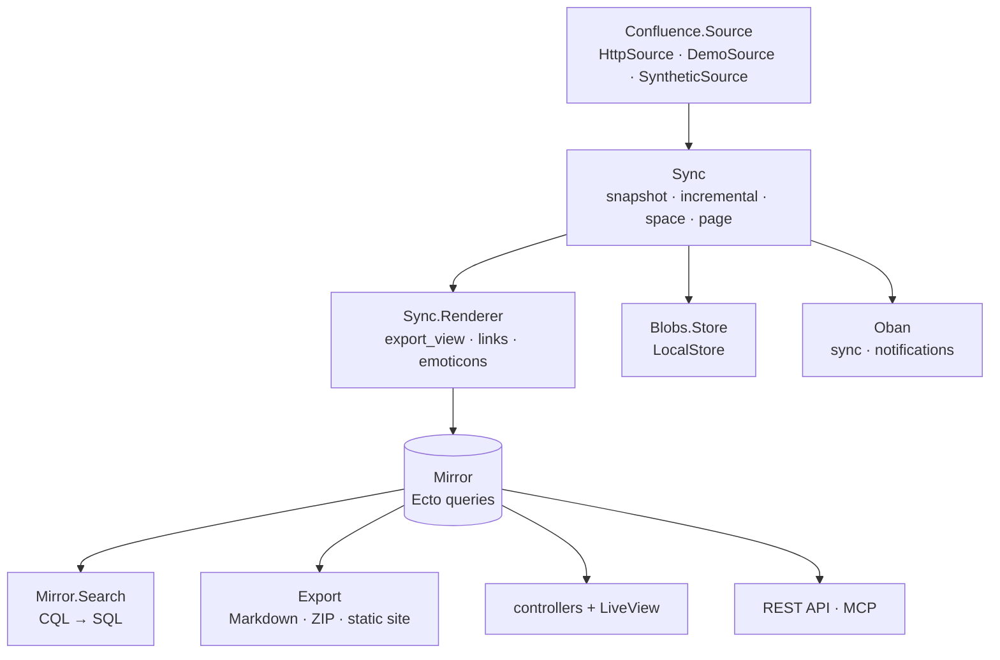

# Developing the mirror

Working on the code itself: invariants, tests and quality gates. The one-page
map of the system — runtime, data, ingestion, search, identity, deployment — is
[architecture.md](architecture.md). Deployment lives in
[operations.md](operations.md), settings in [configuration.md](configuration.md).

## Local setup

```bash
docker compose up -d && mix setup && mix phx.server
```

The [README](../README.md#1-see-it-working) lists the prerequisites and what
each setup command does. Development and test assume an administrator
(`MIRROR_AUTO_ADMIN`), so no sign-in is in the way.

**Done when** `mix lint` is green and `mix test` passes — that is the loop you
will run all day.

`AGENTS.md` carries the Phoenix/Elixir conventions; the invariants below are the
ones specific to the mirror.

## Invariants

* **Read-only.** Content only changes through `Sync` reading a source. Never add
  a write path — no edit tables, forms or "demo edit" mix flags.
* **Upstream changes are source DTOs.** `Confluence.Source` is a behaviour with
  `HttpSource` (REST) and `DemoSource`; test doubles live in `test/support` and
  are injected via `Sync.run(mode, source: Module)`.
* **Search is layered.** The reader UI and `/api/v1/search` take structured
  params (`q`, `space`, `label`, `type`, `creator`, `ancestor`, `updated`),
  compiled to internal CQL by `Mirror.Search.Filters`; `q` is parsed by
  `Mirror.Search.TextQuery`. Raw CQL is public only on the
  Confluence-compatible `/wiki/rest/api` surface. Lexemes keep inner dots and
  hyphens because Postgres `simple` treats `roadmap.csv` as one lexeme.
* **Blob root outside the repo.** `var/mirror` in development,
  `tmp/mirror_test` in test; never `priv/static`.
* **Theme is the site's, variant is the reader's.** `Web.Skins` owns both. The
  theme (`default`, `fresh-blue`, …) is one for the whole site: built-ins are
  daisyUI `@plugin ... daisyui-theme` blocks in `assets/css/app.css`, everything
  else is a declaration emitted per request — from
  `config :confluence_phx_mirror, :skins` or from packs
  (`ConfluencePhxMirrorWeb.Skins.Pack` modules listed in `:skin_packs`, e.g.
  `Skins.FreshBlue`). A declaration may carry `dark_colors`, emitted under
  `[data-scheme="dark"]` plus a `prefers-color-scheme` block. The variant
  (`system`, `light`, `dark`) is the reader's cookie; it only selects a palette.
  Both reach the document through `Skins.attributes/2`, splatted onto `<html>`
  (`data-theme`, `data-scheme`). Deeper overrides go in `assets/css/author.css`.
* **Settings an admin changes live in one table, and a change is one
  transaction.** `settings` (key/value) holds the two kinds of decision an
  administrator owns — the site's theme and the handful of runtime knobs
  (reader limits, notifications, webhook intake). Every key in
  `ConfluencePhxMirror.Settings` has a *default read from the deployment's own
  config*, so a stored value is an override and clearing it hands the decision
  back; that is why there is no second set of defaults in the database. Reads
  come from `:persistent_term`, loaded at boot and refreshed after a write.
  `update/2` validates every field first, then writes the rows and their audit
  entry (`settings.updated`) in one `Repo.transaction`, and only then refreshes
  the cache: a save that cannot be audited does not happen, and a failed save
  leaves both the table and the running site untouched. The web layer asks
  `stored/1` when it needs "did an administrator decide this?" and
  `effective/1` when it needs the value in force — never compare the value in
  force against `nil` for provenance.
* **JS dependencies are real dependencies**: `assets/package.json`, `npm ci`
  wired into `assets.build` / `assets.deploy`. Syntax highlighting uses the
  highlight.js grammar chosen from Confluence's `brush:` attribute.
* **Instants are UTC, everywhere but the screen.** Columns are
  `:utc_datetime`, code writes `DateTime.utc_now() |> DateTime.truncate(:second)`,
  and Confluence timestamps are parsed with `DateTime.from_iso8601/1`, which
  yields the same instant in UTC whatever offset the source used
  (`HttpSource.parse_time/1`). `Web.Time` renders that UTC instant and says so;
  `Web.TimeComponents.local_time/1` emits `<time datetime="…Z">` for
  `assets/js/local_time.js` to rewrite in the browser's zone, because only the
  browser knows it. Never print one zone's wall clock under another's label, and
  never store a zone the mirror cannot vouch for.
* **Page URLs are Confluence's URLs.** `Mirror.Page.slugify/1` reproduces
  Confluence Cloud's rule — ASCII word characters kept, every other run turned
  into one `+`, and no segment at all when nothing survives (`slug` is nullable,
  and those pages are served by id) — and `URLs.page_path/3` omits an empty
  segment. The id is the identity; `Page.slug_match?/2` treats `+` and an
  encoded space alike, and anything else redirects to the canonical URL.
  `Web.WikiController` drops Confluence's `/wiki` prefix. Heading ids come from
  the exported HTML unchanged, so `assets/js/heading_anchors.js` only has to add
  the copyable link.
* **Config is read at boot.** The dev code reloader does not reload
  `config/*.exs`.

## Architecture

The map is [architecture.md](architecture.md); what follows is the layer table to
keep in mind while reading the code.



| Layer | Module | Notes |
|---|---|---|
| Source | `Confluence.Source` | Behaviour; `HttpSource` (REST) and `DemoSource` |
| Ingestion | `Sync` | snapshot / incremental / space / page; per-page error isolation |
| Rendering | `Sync.Renderer` | keeps `export_view`, rewrites links, sanitises, converts expand macros to native `<details>`, turns emoticon images into their character |
| Content | `Mirror` | Ecto queries for pages, trees, backlinks, labels |
| Search | `Mirror.Search` + `Mirror.Search.CQL` | CQL → parameterised SQL over `tsvector` |
| Blobs | `Blobs.Store` / `Blobs.LocalStore` | path-based; S3 can implement the behaviour |
| Export | `Export` + `Export.Site` | Markdown per page, a streaming ZIP per space, and the mirror as a static website (`Site.Content` rewrites links, `Site.HTML` is the shell, `Site.Search` is the offline index, `Site.Chrome` folds the tree and switches the theme) |
| Jobs | Oban | `Sync.SnapshotWorker`, `Sync.PageWorker`, notification workers |
| Web | controllers + LiveView | reader UI, admin dashboard, REST API, webhooks |
| Presence | `Web.Presence` + `PagePresenceLive` / `SitePresenceLive` | who is reading a page, and how many readers are online; each is a LiveView rendered into the page, since the page itself is a controller response. `PagePresenceLive` is rendered twice — the rail names the readers and owns the tracking, the metadata row repeats only the count where the rail is hidden (`presence_variant: "compact"`, subscribe without track) |
| Accounts | `Accounts` | magic links, proxy auth, API tokens, Phoenix 1.8 `Scope` |
| Audit | `Audit` | append-only; syncs, webhooks, accounts, attachments |

### Sync semantics

What a sync *does* is the [site admin guide](site-admin-guide.md#pulling-content)'s
subject. The two facts that belong here are code-level:

* **a run is a `SyncRun`** (`running` → `succeeded` / `partial` / `failed`) with
  counters and errors, and a failure is recorded per page: one broken attachment
  or comment does not abort the run;
* **a snapshot upserts every page first, then renders**, so cross-space links
  resolve even when the target space appears later in the same run.

## Tests

Tests are grouped by the question they answer:

| Level | Files | Question |
| --- | --- | --- |
| Feature (`FeatureCase` + `phoenix_test`) | `test/…_web/features/` | can a reader get from A to B? |
| LiveView | `test/…_web/live_views_test.exs` | what happens when a reader interacts? |
| Controller | `test/…_web/controllers/` | what does one request return? |
| API | `test/…_web/api_test.exs` | what does the JSON surface promise? |
| Unit | `test/…/mirror`, `test/…/sync`, `test/…/blobs` | what does a pure module decide? |

Feature tests use `PhoenixTest`, so they do not care whether a page is a
controller or a LiveView: they visit, click, fill and assert the same way a
reader would, and assert on paths and visible text rather than markup.

Covered: the CQL grammar, the renderer (cross-links, attachments, sanitising,
native expand macros), blob keys/store, full sync + idempotency, updated pages
arriving through a sync, deletions, notifications, magic links, API tokens,
webhook signatures and Presence.

```bash
mix test                 # the suite
mix test test/path_test.exs
mix test --failed
```

Tests start processes with `start_supervised!/1`; wait for a process with
`Process.monitor/1` / `_ = :sys.get_state/1` rather than `Process.sleep/1`.

### Adding a macro renderer

A dynamic macro is one module behind one behaviour, and teaching the mirror a new
one is three steps:

1. `lib/confluence_phx_mirror/sync/dynamic_content/renderers/my_macro.ex` —
implement `ConfluencePhxMirror.Sync.DynamicContent.Renderer`, that is
`render(attrs, context)`, and answer with `Floki` nodes from
`Sync.DynamicContent.Nodes`. `attrs` are the marker's `data-*` names without the
prefix; `context` carries the page, its space, its headings and the content
port.
2. One line in `Sync.DynamicContent.Registry`.
3. A spec in `test/confluence_phx_mirror/sync/dynamic_content/` that expands the
marker through `DynamicContent.expand/2`, naming
`ConfluencePhxMirror.Sync.DynamicContent.StubContent` as the port:

```elixir
StubContent.script(children: [page])
html = DynamicContent.expand(marker, %{space: space, page: page, source: StubContent})
```

Do not query the database from a renderer: add a callback to
`Sync.DynamicContent.Source` (and to `Source.Mirror`) instead. That is where the
audience rule is applied — a macro is resolved once, for every reader of the
page, so what it lists may only be what those readers may open.

### Adding a vendor extension

A third-party macro that needs nothing but its own page is an *extension*, not a
renderer: it runs while the storage is sanitised and receives the macro's name,
its `<ac:parameter>` values and its already-rewritten body.

1. `lib/confluence_phx_mirror/sync/vendor_macros/<vendor>.ex` — one file per
app, implementing `ConfluencePhxMirror.Sync.VendorMacros.Extension`. Its
`draw/1` gets `%{name: "aura-tab", parameters: %{"title" => "Install"}, body:
[...]}` and answers with `Floki` nodes.
2. One line per `ac:name` in `ConfluencePhxMirror.Sync.VendorMacros`.
3. A spec in `test/confluence_phx_mirror/sync/vendor_macros_test.exs` — storage
node in, HTML out, no database.

Two rules decide whether an extension belongs at all. **Draw the body**: the
fallback keeps it, so an extension that understands the wrapper should hand it
on rather than start from scratch. And **do not invent**: a macro whose point is
a live query, a writable form or a ticking clock cannot be answered from a stored
page, so it stays with the fallback, which says what it was and shows what the
page still holds.

### Mind the Markdown export

Whatever a renderer or an extension emits is exported twice: as the page a reader
opens, and as Markdown in the site archive. Only a few shapes survive the second
trip, so choose them deliberately — a heading, a paragraph, a list, a pipe table,
a `pre` for source, and `details`/`summary` for anything collapsible. The
not-implemented widget (`Sync.MacroPlaceholder`) is a `blockquote` for exactly
this reason: the exporter already turns a quote into a `>` block, so the note
reads as a note in both outputs instead of being flattened into prose.

A renderer that needs a shape the exporter cannot express is a sign the macro
should render plainer, not that the exporter needs a special case.

### Who is reading, and which deployment

Two pieces of global state decide what a test sees, and the suite keeps both
out of the way:

* **The reader.** `config/test.exs` sets `auto_admin: false`, so no test inherits
  an administrator from the deployment. A test that needs an identity says which
  one — `log_in(conn, user)` or `log_in_admin(conn)` from `ConnCase` — and one
  file, `test/…_web/auto_admin_test.exs`, turns the development convenience on
  to test it. That file is `async: false`, because it changes the whole node.
* **The deployment.** A handful of tests are *about* configuration: a mirror
  pointed at a real site, a seeded administrator, a source that fails on
  purpose. They write it through `ConfluencePhxMirror.TestConfig`, the only
  place in the suite that touches the application environment: the first write
  of a key remembers what was there and puts it back when the test ends, so no
  test can forget (a leaked `:admins` once made four unrelated last-admin tests
  see a second administrator). `TestConfig.with/2` is the same for one
  expression. Everything else is passed in — `Sync.run(mode, source: Module)`,
  a `%Scope{}`, a `%User{}` — which is what keeps the suite concurrent.

`async: true` is the default where nothing global is touched. What still forces
`async: false` is the shared blob root (`demo_snapshot!` writes real files) and
`empty_mirror!`, whose deletes cascade into the same committed rows from both
sides and deadlock beside another such test.

### Reading at scale

The demo snapshot is a dozen pages, and a page view that quietly loads a whole
space looks like a fast one there. What runs at scale, how to start a server on
generated content of a chosen size, how to read the reports and what the current
numbers are: [performance.md](performance.md).

## Quality gates

One script runs everything and prints one summary; the `mix` aliases below are
what it calls, and are worth running on their own while working:

```bash
scripts/quality.sh              # lint, types, suite with coverage, CRAP report (what CI runs on a push)
scripts/quality.sh --fast       # static analysis only — lint and types: no database, no tests
scripts/quality.sh --image      # …and build the image, checking it runs as uid 10001
scripts/quality.sh --top 20     # rank more CRAP entries (default 8)

mix lint                        # compile --warnings-as-errors, unused deps, format, credo --strict, sobelow
mix types                       # dialyzer: every spec against the code that has to keep it
mix cover                       # the suite with the coverage export the complexity gate needs
mix complexity                  # CRAP over the application code (verbose table)
mix precommit                   # the script, so CI and a laptop agree
```

The script is read-only: it runs `format --check-formatted` and
`deps.unlock --check-unused`, so a report never rewrites a file. Run
`mix format` yourself when it complains.

### What CI runs

`.github/workflows/ci.yml` runs four jobs. The first three gate every push and
pull request; the fourth gates every push, and publishes only when asked.

| Job | What it is | Cost |
| --- | --- | --- |
| **Static analysis** | `mix lint` — compile with warnings as errors, unused deps, format, `credo --strict`, sobelow | ~30 s |
| **Types** | `mix types` — dialyzer over the app and its specs, against a PLT of OTP, Elixir and the deps | seconds warm; the PLT is minutes when the cache misses |
| **Suite and complexity** | Postgres service, `mix cover`, then `mix complexity` (CRAP, threshold 30). This is the gate that matters | ~7.5 min |
| **Image, scan, non-root** | `docker build` (amd64), Trivy (`CRITICAL,HIGH`, `ignore-unfixed`), `id -u` must be `10001`, then publish | ~2 min, plus ~15 min for the arm64 half under QEMU |

The image job `needs` the other three, so nothing is published from a commit that
failed them. A push publishes the amd64 image the checks had to build anyway; a
release tag or `gh workflow run ci --field image=true` adds the arm64 half. What
that image ends up tagged as: [deployment.md](deployment.md#releases-and-images).

`mix lint` needs no database and no test run (about two seconds), so it is the
one to keep in a file-watcher or a pre-commit hook. `mix format
--check-formatted`, `mix credo --strict` and `mix lint.sobelow --config` can of
course be run on their own.

`mix lint.sobelow` is sobelow with one thing taken out: sobelow reads `mix.lock`
with `Code.string_to_quoted/1` to compare locked versions against its advisory
list, and Elixir 1.20 warns about every quoted key in that file — sixty-nine
lines, one per dependency, none of them actionable. The task drops exactly that
block when it names a package this project locks, says how many it dropped, and
passes everything else through, so a warning from our own source still prints.

Sobelow runs with `skip: true`, so every accepted finding is either a
`# sobelow_skip [...]` comment with its reason at the call site (sanitised HTML,
the parameterised CQL builder, blob keys) or an entry in `.sobelow-skips` for a
reviewed template. Regenerate those entries with
`mix sobelow --config --mark-skip-all` only after reviewing them again. The
reader pipeline answers `Config.CSP` with a real Content-Security-Policy:
scripts only from the mirror itself, inline styles allowed for Confluence's own
markup.

`mix crap` (ex_crap) scores every function by cyclomatic complexity and its test
coverage, so untested complexity becomes a ranked queue instead of a vague
feeling. It reads exported coverage data, which is why the complexity step
follows the coverage step:

```bash
mix cover && mix crap --verbose   # full table; `mix crap` prints only the offenders
```

The threshold is the conventional `30` (a complexity-5 function with no tests),
applied to the application code in `lib/confluence_phx_mirror` and
`lib/confluence_phx_mirror_web`. Only the operator CLIs under `lib/mix/tasks`
stay outside the gate — their argument parsing and shell output are exercised by
hand, not by the suite. Keep both trees in the alias: `crap` takes one path, and
Mix refuses to run the same task twice in one invocation, which is why the two
runs go through `cmd`.

The report ranks three ways because they answer different questions: the
per-function list says what to fix, the per-file list says where a file's worst
spot is, and the per-tree line says whether a whole layer needs attention.

### Types: dialyzer

`mix types` asks a different question from the rest of the gate: not whether a
line is exercised, but whether the specs are true. It finds the shapes no test
does — a spec that promises a plain map and gets a struct, a call site passing
the wrong term, a clause that can never match.

It is its own gate because of the PLT, the pre-analysed image of OTP, Elixir and
the deps that it checks the app against. Building one takes minutes on a machine
that has never run it; after that it is reused until a version in `mix.lock`
moves, which is why CI caches `_build` for this job and why it is not part of
`mix lint`.

```bash
mix types                                        # seconds, once the PLT exists
rm -rf _build/dev/dialyxir_*.plt && mix types    # after an OTP or Elixir upgrade
```

There is no ignore file, on purpose. Every finding so far was true, and each was
fixed where it was told. `unused_fun` is the one to read as a symptom rather than
noise: here it meant "the call above this block cannot succeed, so the rest of it
is dead", which is how a spec promising a plain map for a `%Page{}` argument
surfaced as three unreachable functions two hundred lines away. Fix the contract
and the three disappear.

`plt_add_apps` in `mix.exs` is not decoration. `:mix` is what makes `mix.exs`
itself typed instead of opaque — the version string comes from `Mix.Project` —
and `:ex_unit` is what the case templates in `test/support` need. The rest of the
list is the deps this app marks `runtime: false`: `esbuild` and `tailwind`, which
`mix assets.install` calls, and `phoenix_test`, which the feature cases call.
Compiled, but not among the app's applications, they are invisible to dialyzer
until they are named there — and then a `mix lint`-clean tree reports six calls
to functions that "do not exist". `:phoenix_test` is added only for `:test`,
where the dep exists.

## License

The code is under the Mozilla Public License 2.0 ([LICENSE](../LICENSE), and
`package: [licenses: ["MPL-2.0"]]` in `mix.exs`). MPL is file-scoped: a modified
file stays under the MPL, the rest of a system built around it need not. There
are no per-file notices — the repository `LICENSE` is the notice — so new files
need no header; contributions come in under the same licence.

## Changing behaviour

A user-, admin- or operator-facing change is not done until the matching guide
under `docs/` says so: [site-admin-guide.md](site-admin-guide.md),
[operations.md](operations.md), [configuration.md](configuration.md),
[api.md](api.md). Migrations belong in
[operations.md](operations.md#migrate-as-a-deploy-step).
